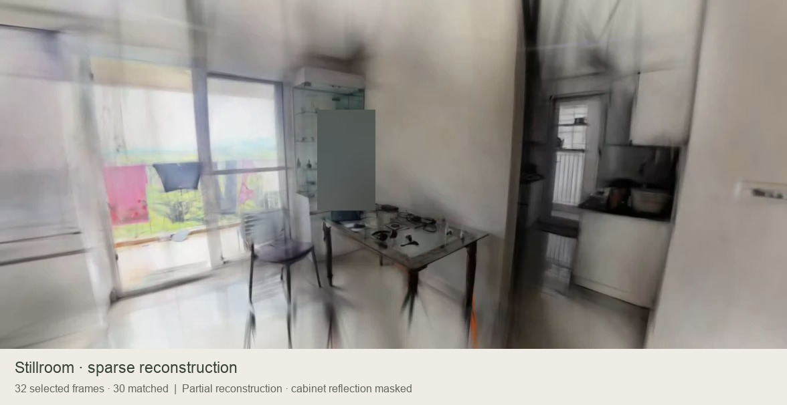

# Real-room reconstruction walkthrough

[Watch the recording](stillroom-sparse-walkthrough.mp4)

Recorded directly from Stillroom's WebGL room viewer on 11 October 2026. This shows the experimental sparse reconstruction from 32 selected video frames, 30 of which joined the reconstructed camera group. It is a partial, approximate scene; the match count does not measure physical room completeness.

The camera pans across the window, table and kitchen entrance, avoiding the occupied seating area. A tracked privacy mask covers the camera-holder reflection in the glass cabinet throughout the recording. There is no audio. The reconstruction was not generatively enhanced or completed for this clip. Original source footage, photographs and the private 3D asset are not included in this repository.

The published MP4 is about 11 seconds, H.264, 30 frames per second and 1176 × 606 pixels, including an informational footer. The viewer capture itself is 1176 × 522 pixels. Encoding and the privacy mask are the only edits to the captured scene. The poster uses the same masked export.
